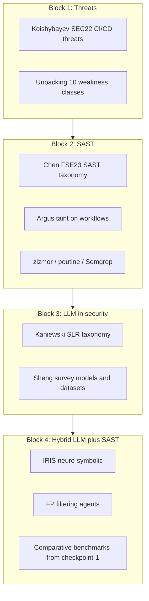

# Checkpoint 2 — Literature Background (draft)

Topic: applying LLMs to security testing with comparative evaluation against SAST, focused on **vulnerability detection in CI/CD pipeline configurations** (primarily GitHub Actions YAML).

---

## 1. Which SAST methods to use

### 1.1 SAST taxonomy (conceptual)

| Type | Idea | Examples | Role in diploma | Representative papers |
|------|------|----------|-----------------|-----------------------|
| **Pattern / rule-based** | Template rules on YAML or code | Semgrep, SonarQube, SpotBugs | Stable, reproducible baseline | [Chen FSE 2023](https://sen-chen.github.io/pdf/C38-FSE2023-Comparison%20and%20Evaluation%20on%20Static%20Application%20Security%20Test%20(SAST)%20Tools%20for%20Java.pdf); [LLM vs SAST](https://arxiv.org/abs/2506.15212); [LLM vs SCA](https://doi.org/10.1109/ACCESS.2025.3635168) |
| **Semantic / taint analysis** | Track untrusted data from sources to sinks | CodeQL, Argus, IRIS+CodeQL | Closer to real vulnerability analysis | [IRIS](https://arxiv.org/abs/2405.17238); [Argus](https://www.usenix.org/system/files/usenixsecurity23-muralee.pdf); [CPGHunter](https://doi.org/10.1007/s10664-026-10842-2) |
| **Domain-specific workflow scanners** | Built for `.github/workflows/` | zizmor, poutine, actionlint, GHAST | **Direct fit for pipeline configs** | [Unpacking GHA Scanners](https://arxiv.org/abs/2601.14455); [GHAST](https://arxiv.org/abs/2208.03837) |
| **Linter + security hybrid** | Syntax checks plus partial security | actionlint, OpenSSF Scorecard | Misconfigurations, not only CVE classes | [Unpacking GHA Scanners](https://arxiv.org/abs/2601.14455); [OWASP GHA Cheat Sheet](https://cheatsheetseries.owasp.org/cheatsheets/GitHub_Actions_Security_Cheat_Sheet.html) |

### 1.2 General SAST background (source code, transferable methodology)

| Paper | Link | Use for background |
|-------|------|--------------------|
| Chen et al., FSE 2023 — *Comparison and Evaluation on SAST Tools for Java* | [PDF](https://sen-chen.github.io/pdf/C38-FSE2023-Comparison%20and%20Evaluation%20on%20Static%20Application%20Security%20Test%20(SAST)%20Tools%20for%20Java.pdf) | CWE mapping, taint vs rules, CodeQL / Semgrep / SpotBugs, evaluation pitfalls |
| CASTLE, TASE 2025 | [arXiv 2503.09433](https://arxiv.org/abs/2503.09433) | 13 SAST + 10 LLM on 250 C micro-benchmarks; Juliet/SARD limitations; CASTLE Score |
| RealVuln, 2026 | [arXiv 2604.13764](https://arxiv.org/abs/2604.13764) | Benchmark landscape table (OWASP, Juliet, CASTLE, CWE-Bench, etc.) |

### 1.3 SAST for pipeline / GitHub Actions (primary domain)

Literature defines **10 common weakness classes** for GitHub Actions workflows (injection, excessive permissions, unpinned actions, secrets exposure, etc.).

| Tool | Strategy | Role in hybrid pipeline | Paper |
|------|----------|-------------------------|-------|
| **poutine** | Conservative, few high-severity findings | Strict SAST baseline | [Unpacking GHA Scanners](https://arxiv.org/abs/2601.14455) |
| **zizmor** | Broad coverage, more noise | Maximum SAST recall | [Unpacking GHA Scanners](https://arxiv.org/abs/2601.14455) |
| **actionlint** | Syntax and runner compatibility | Structural workflow errors | [Unpacking GHA Scanners](https://arxiv.org/abs/2601.14455) |
| **Semgrep** | YAML rules, easy to extend | Custom rule baseline | [Unpacking GHA Scanners](https://arxiv.org/abs/2601.14455) |
| **CodeQL (`language: actions`)** | GitHub semantic rules | Industry standard (CLI/extractor limitations in local experiments) | [Unpacking GHA Scanners](https://arxiv.org/abs/2601.14455); [OWASP GHA Cheat Sheet](https://cheatsheetseries.owasp.org/cheatsheets/GitHub_Actions_Security_Cheat_Sheet.html) |
| **Argus** | Staged static taint on workflows + actions | Best academic reference for taint on GHA | [Argus (USENIX SEC'23)](https://www.usenix.org/system/files/usenixsecurity23-muralee.pdf) |
| **GHAST** | Checklist of misconfigurations in YAML | Early GHA security methodology | [GHAST](https://arxiv.org/abs/2208.03837) |

**Recommended SAST stack for experiments:**

- **Pipeline baseline:** `poutine + zizmor` (as in [Unpacking paper](https://arxiv.org/abs/2601.14455)) ± Semgrep for custom rules.
- **Background reference architecture:** [Argus](https://www.usenix.org/system/files/usenixsecurity23-muralee.pdf) (WIR + taint summaries for third-party actions).
- **Cross-paper comparison baseline:** CodeQL + Semgrep + SonarQube (as in [LLM vs SAST](https://arxiv.org/abs/2506.15212), [LLM vs SCA](https://doi.org/10.1109/ACCESS.2025.3635168), [Harnessing LLM](https://doi.org/10.1109/ACCESS.2025.3541146)).

### 1.4 SAST tools used per study

| Study | Link | SAST / static tools used |
|------|------|---------------------------|
| **IRIS** | [arXiv 2405.17238](https://arxiv.org/abs/2405.17238) | CodeQL (base static taint engine) + LLM-assisted specs/filtering |
| **Sifting the Noise** | [arXiv 2601.22952](https://arxiv.org/abs/2601.22952) | CodeQL alerts as input; evaluation on [OWASP Benchmark](https://owasp.org/www-project-benchmark/) and [Vul4J](https://github.com/SAP/project-kb/tree/main/Vul4J) |
| **LLM vs SAST** | [arXiv 2506.15212](https://arxiv.org/abs/2506.15212) | SonarQube + Cloud Defence (combined SAST baseline) |
| **LLM vs SCA** | [IEEE Access 3635168](https://doi.org/10.1109/ACCESS.2025.3635168) | SonarQube, CodeQL, SnykCode |
| **Harnessing LLM** | [IEEE Access 3541146](https://doi.org/10.1109/ACCESS.2025.3541146) | CodeQL, SpotBugs |
| **Argus** | [USENIX SEC'23 PDF](https://www.usenix.org/system/files/usenixsecurity23-muralee.pdf) | ARGUS (staged static taint analysis for workflows/actions) |
| **GHAST** | [arXiv 2208.03837](https://arxiv.org/abs/2208.03837) | GHAST workflow static checks (misconfiguration-oriented) |
| **Unpacking GHA Scanners** | [arXiv 2601.14455](https://arxiv.org/abs/2601.14455) | actionlint, poutine, zizmor, scorecard, semgrep, ggshield, frizbee, pinny, scharf |
| **Chen FSE 2023** | [PDF](https://sen-chen.github.io/pdf/C38-FSE2023-Comparison%20and%20Evaluation%20on%20Static%20Application%20Security%20Test%20(SAST)%20Tools%20for%20Java.pdf) | Broad Java SAST set; key baselines include CodeQL, Semgrep, SpotBugs, SonarQube |
| **CASTLE** | [arXiv 2503.09433](https://arxiv.org/abs/2503.09433) | 13 static analyzers + 2 formal verification tools (incl. ESBMC); see [CASTLE repo](https://github.com/CASTLE-Benchmark/CASTLE-Benchmark) |
| **CPGHunter** | [DOI 10.1007/s10664-026-10842-2](https://doi.org/10.1007/s10664-026-10842-2) | CodeQL baseline + LLM-guided taint modeling |
| **AdaTaint** | [arXiv 2511.04023](https://arxiv.org/abs/2511.04023) | Static taint engine + LLM-inferred source/sink specs |

---

## 2. Which LLM types and subtypes to use

### 2.1 Model families

| Category | Models | When to use | Representative papers |
|----------|--------|-------------|-----------------------|
| **General-purpose frontier** | GPT-4 / GPT-4o, Claude 3.5 Sonnet, Gemini 1.5 | Zero-shot, CoT, triage, agents — **main choice without fine-tuning** | [IRIS](https://arxiv.org/abs/2405.17238); [LLM vs SAST](https://arxiv.org/abs/2506.15212); [Sheng survey](https://arxiv.org/abs/2502.07049) |
| **Code-specialized** | CodeLlama, DeepSeek-Coder, CodeQwen, StarCoder | Compare code-tuned vs general models | [Kaniewski SLR](https://arxiv.org/abs/2507.22659); [Sheng survey](https://arxiv.org/abs/2502.07049); [CASTLE](https://arxiv.org/abs/2503.09433) |
| **Encoder / hybrid DL** | CodeBERT + CNN/GNN | Pre-LLM era background; secondary for this topic | [Kaniewski SLR](https://arxiv.org/abs/2507.22659); [Sheng survey](https://arxiv.org/abs/2502.07049) |
| **Security fine-tuned** | Rare, mostly Solidity/smart contracts | Not standard for pipeline YAML | [Fu et al. 2024](https://arxiv.org/abs/2404.02525); [Sheng survey](https://arxiv.org/abs/2502.07049) |

**Practical minimum for diploma (2–3 models):**

1. GPT-4o or Claude 3.5 — primary (IRIS, FP-filtering, comparative benchmarks).
2. One open-weight code model (DeepSeek-Coder / CodeLlama) — cost and reproducibility.
3. Optional: agentic framework (OpenHands / SWE-agent) if LLM = post-SAST triage layer.

### 2.2 Usage modes (more important than model choice)

| Mode | Description | Key papers |
|------|-------------|------------|
| **Zero- / few-shot classification** | “Is this YAML vulnerable?” | [LLM vs SAST](https://arxiv.org/abs/2506.15212); [LLM vs SCA](https://doi.org/10.1109/ACCESS.2025.3635168) |
| **Prompt engineering** | CoT, ToT, self-consistency | [Harnessing LLM](https://doi.org/10.1109/ACCESS.2025.3541146) |
| **Neuro-symbolic hybrid** | LLM infers specs / filters + SAST engine | [IRIS](https://arxiv.org/abs/2405.17238); [AdaTaint](https://arxiv.org/abs/2511.04023); [CPGHunter](https://doi.org/10.1007/s10664-026-10842-2) |
| **Agentic triage** | Multi-step analysis with tools | [Sifting the Noise](https://arxiv.org/abs/2601.22952) |
| **PoV / test generation** | Demonstrate exploitability, not just labels | [Supply chain / ChatGPT](https://arxiv.org/abs/2310.00710) |

For pipeline security, **hybrid** and **triage** are better justified than “LLM replaces SAST”.

### 2.3 LLMs used per study

| Study | Link | LLM(s) used |
|------|------|--------------|
| **IRIS** | [arXiv 2405.17238](https://arxiv.org/abs/2405.17238) | GPT-4 (best reported setup) |
| **Sifting the Noise** | [arXiv 2601.22952](https://arxiv.org/abs/2601.22952) | Claude Sonnet 4, DeepSeek Chat, GPT-5; agent frameworks: Aider, OpenHands, SWE-agent |
| **LLM vs SAST** | [arXiv 2506.15212](https://arxiv.org/abs/2506.15212) | GPT-4 (Advanced Data Analysis / Code Interpreter mode) |
| **LLM vs SCA** | [IEEE Access 3635168](https://doi.org/10.1109/ACCESS.2025.3635168) | GPT-4.1, Mistral Large, DeepSeek V3 |
| **Harnessing LLM** | [IEEE Access 3541146](https://doi.org/10.1109/ACCESS.2025.3541146) | GPT-4 Turbo, GPT-4, Claude 3 Opus (CoT / ToT / self-consistency) |
| **Supply chain / ChatGPT** | [arXiv 2310.00710](https://arxiv.org/abs/2310.00710) | ChatGPT (GPT-family) for PoV test generation |
| **CASTLE** | [arXiv 2503.09433](https://arxiv.org/abs/2503.09433) | 10 LLMs benchmarked (see [CASTLE repo](https://github.com/CASTLE-Benchmark/CASTLE-Benchmark)) |
| **CPGHunter** | [DOI 10.1007/s10664-026-10842-2](https://doi.org/10.1007/s10664-026-10842-2) | LLM-guided semantic modeling (paper uses LLM for API/source-sink inference) |
| **AdaTaint** | [arXiv 2511.04023](https://arxiv.org/abs/2511.04023) | LLM-driven source/sink identification + neuro-symbolic validation |
| **Kaniewski SLR** | [arXiv 2507.22659](https://arxiv.org/abs/2507.22659) | Taxonomy: GPT, Claude, Gemini, LLaMA, CodeLlama, DeepSeek, CodeBERT-family, others |
| **Sheng survey** | [arXiv 2502.07049](https://arxiv.org/abs/2502.07049) | Frequent: GPT-4/GPT-3.5, CodeLlama, CodeBERT-family, other code LLMs |

---

## 3. Datasets

### 3.1 CI/CD and GitHub Actions (best fit)

| Dataset | Scale | Ground truth | Paper | Dataset link |
|---------|-------|--------------|-------|--------------|
| **Unpacking workflow corpus** | 2,722 workflows, 388 repos | Scanner alerts mapped to 10 weakness classes | [arXiv 2601.14455](https://arxiv.org/abs/2601.14455) | [github.com/sparkrew/github-actions-security](https://github.com/sparkrew/github-actions-security) |
| **Argus evaluation** | ~2.7M workflows; 5,298 confirmed injections (manual subset) | Manual validation | [Argus (USENIX SEC'23)](https://www.usenix.org/system/files/usenixsecurity23-muralee.pdf) | — (paper + artifact references) |
| **Koishybayev SEC'22** | 447,238 workflows, 213,854 repos | Empirical statistics, not full per-alert labels | [Characterizing Security of GitHub CI](https://www.usenix.org/system/files/sec22-koishybayev.pdf) | — (empirical study) |
| **GHAST campaign** | 50 projects, 131 workflows | Rule-based checks SC-1..SC-N | [GHAST](https://arxiv.org/abs/2208.03837) | — (methodology paper) |

**Gap:** there is no standard benchmark “LLM vs SAST on pipeline YAML with CVE-level labels”. Likely approach:

- Start from open corpus (Unpacking / Argus subset),
- Manually label a subset (template: [IRIS](https://arxiv.org/abs/2405.17238) → [CWE-Bench-Java](https://github.com/iris-sast/cwe-bench-java)),
- Or synthesize vulnerable / fixed YAML pairs.

### 3.2 Transferable benchmarks (methodology, not domain)

| Dataset | Type | Pros | Cons for pipeline | Used in papers |
|---------|------|------|---------------------|----------------|
| **Juliet Java/C++ 1.3** | Synthetic | Clean labels, CoT experiments | Not YAML; possible LLM training leakage | [Harnessing LLM](https://doi.org/10.1109/ACCESS.2025.3541146); [CASTLE](https://arxiv.org/abs/2503.09433); [CPGHunter](https://doi.org/10.1007/s10664-026-10842-2) |
| **OWASP Benchmark** | Synthetic Java | FP triage, statistical tests | Not CI/CD | [Sifting the Noise](https://arxiv.org/abs/2601.22952) |
| **CWE-Bench-Java** | 120 real CVEs | Whole-repo, IRIS baseline | Java code, not workflows | [IRIS](https://arxiv.org/abs/2405.17238); [CPGHunter](https://doi.org/10.1007/s10664-026-10842-2) |
| **CASTLE-C250** | 250 C programs, 25 CWEs | SAST + LLM side-by-side | Micro-benchmark | [CASTLE](https://arxiv.org/abs/2503.09433) |
| **RealVuln** | 26 real vulnerable repos | Real-world scanners | Not pipeline-specific | [RealVuln](https://arxiv.org/abs/2604.13764) |
| **Vul4J** | Reproducible Java CVEs | FP filtering paper (CodeQL alerts) | Java, not YAML | [Sifting the Noise](https://arxiv.org/abs/2601.22952) |
| **Big-Vul / DiverseVul** | Large function-level | ML scale | Noisy labels | [Kaniewski SLR](https://arxiv.org/abs/2507.22659); [Sheng survey](https://arxiv.org/abs/2502.07049) |
| **Unpacking GHA corpus** | Real workflows | Direct pipeline fit | Scanner-based ground truth | [Unpacking GHA Scanners](https://arxiv.org/abs/2601.14455) |

### 3.3 Benchmark and dataset links

| Benchmark / dataset | Dataset link | Paper(s) using it |
|---------------------|--------------|-------------------|
| **Juliet C/C++ 1.3 (SARD)** | [samate.nist.gov/SARD/test-suites/112](https://samate.nist.gov/SARD/test-suites/112) | [CASTLE](https://arxiv.org/abs/2503.09433); [CPGHunter](https://doi.org/10.1007/s10664-026-10842-2) |
| **Juliet Java 1.3 (SARD)** | [samate.nist.gov/SARD/test-suites/111](https://samate.nist.gov/SARD/test-suites/111) | [Harnessing LLM](https://doi.org/10.1109/ACCESS.2025.3541146); [CPGHunter](https://doi.org/10.1007/s10664-026-10842-2) |
| **OWASP Benchmark** | [owasp.org/www-project-benchmark](https://owasp.org/www-project-benchmark/) | [Sifting the Noise](https://arxiv.org/abs/2601.22952) |
| **CWE-Bench-Java** | [GitHub](https://github.com/iris-sast/cwe-bench-java) / [Hugging Face](https://huggingface.co/datasets/iris-sast/CWE-Bench-Java) | [IRIS](https://arxiv.org/abs/2405.17238); [CPGHunter](https://doi.org/10.1007/s10664-026-10842-2) |
| **CASTLE-C250** | [github.com/CASTLE-Benchmark](https://github.com/CASTLE-Benchmark/CASTLE-Benchmark) | [CASTLE](https://arxiv.org/abs/2503.09433) |
| **RealVuln** | [arXiv 2604.13764](https://arxiv.org/abs/2604.13764) | [RealVuln](https://arxiv.org/abs/2604.13764) |
| **Vul4J** | [github.com/SAP/project-kb/Vul4J](https://github.com/SAP/project-kb/tree/main/Vul4J) | [Sifting the Noise](https://arxiv.org/abs/2601.22952) |
| **Big-Vul** | [huggingface.co/datasets/bstee615/bigvul](https://huggingface.co/datasets/bstee615/bigvul) | [Kaniewski SLR](https://arxiv.org/abs/2507.22659) |
| **DiverseVul** | [github.com/wagner-group/diversevul](https://github.com/wagner-group/diversevul) | [Kaniewski SLR](https://arxiv.org/abs/2507.22659) |
| **Unpacking GHA workflows** | [github.com/sparkrew/github-actions-security](https://github.com/sparkrew/github-actions-security) | [Unpacking GHA Scanners](https://arxiv.org/abs/2601.14455) |
| **Argus workflow corpus** | [USENIX SEC'23 Argus paper](https://www.usenix.org/system/files/usenixsecurity23-muralee.pdf) | [Argus](https://www.usenix.org/system/files/usenixsecurity23-muralee.pdf) |
| **Koishybayev GHA corpus** | [USENIX SEC'22 PDF](https://www.usenix.org/system/files/sec22-koishybayev.pdf) | [Characterizing Security of GitHub CI](https://www.usenix.org/system/files/sec22-koishybayev.pdf) |

**Strategy:**

- **Background + metrics design:** Juliet, OWASP, CASTLE (from surveys).
- **Main experiment:** curated **pipeline YAML dataset** (Unpacking corpus + manual labels).
- **Benchmark construction reference:** [CWE-Bench-Java](https://github.com/iris-sast/cwe-bench-java) + [IRIS](https://arxiv.org/abs/2405.17238) paper.

---

## 4. Role of LLM

Consensus from checkpoint-1 papers and recent SLRs:

```
SAST (deterministic)              LLM (contextual)
─────────────────────             ─────────────────────────────
Rules / taint engine        ←──→  Infer sources/sinks/specs
Reproducible alerts         ←──→  Filter false positives
CWE mapping                 ←──→  Explain why alert matters
Misses cross-step context   ←──→  Reason over full workflow YAML
High FP on edge cases       ←──→  Triage in CI/CD pipeline
```

### Five documented LLM roles

1. **Specification inference** — infer taint sources/sinks for unknown actions ([IRIS](https://arxiv.org/abs/2405.17238), [AdaTaint](https://arxiv.org/abs/2511.04023), [CPGHunter](https://doi.org/10.1007/s10664-026-10842-2)).
2. **Alert triage / FP filtering** — post-processing after SAST ([Sifting the Noise](https://arxiv.org/abs/2601.22952), [IRIS](https://arxiv.org/abs/2405.17238)).
3. **Contextual classification** — direct vulnerable / not on config snippets ([LLM vs SAST](https://arxiv.org/abs/2506.15212), [LLM vs SCA](https://doi.org/10.1109/ACCESS.2025.3635168)).
4. **Reasoning strategies** — CoT / ToT / self-consistency for ambiguous cases ([Harnessing LLM](https://doi.org/10.1109/ACCESS.2025.3541146)).
5. **Actionable output** — PoV tests, patch hints, severity ([Supply chain / ChatGPT](https://arxiv.org/abs/2310.00710)).

**Not a primary role:** replacing the taint engine or acting as the sole merge gate without SAST (hallucination risk, non-determinism).

**Working thesis conclusion:** LLMs are most effective as an **intelligent amplifier** of security testing: SAST gives stable baseline coverage; LLMs add contextual reasoning, noise reduction, and triage support.

---

## 5. Background papers (priority for Related Work)

### Tier 1 — Surveys and taxonomies (foundation)

| # | Paper | Link | Background contribution |
|---|-------|------|-------------------------|
| 1 | Kaniewski et al., SLR (ACM TOSEM) | [arXiv 2507.22659](https://arxiv.org/abs/2507.22659) / [DOI 10.1145/3815425](https://doi.org/10.1145/3815425) | Task formulation, architectures, adaptation, **dataset table**; [Awesome-LLM4SVD](https://github.com/hs-esslingen-it-security/Awesome-LLM4SVD) |
| 2 | Sheng et al., 2025 | [arXiv 2502.07049](https://arxiv.org/abs/2502.07049) | LLM families, benchmarks, prompts, gaps (repo-level, leakage) |
| 3 | MDPI Electronics 2025 | [DOI 10.3390/electronics14224449](https://doi.org/10.3390/electronics14224449) | Static → ML → LLM evolution; neuro-symbolic direction |
| 4 | Fu et al., 2024 | [arXiv 2404.02525](https://arxiv.org/abs/2404.02525) | LLM adaptation for detection and repair; limitations |

### Tier 2 — SAST background

| # | Paper | Link | Background contribution |
|---|-------|------|-------------------------|
| 5 | Chen, FSE 2023 | [PDF](https://sen-chen.github.io/pdf/C38-FSE2023-Comparison%20and%20Evaluation%20on%20Static%20Application%20Security%20Test%20(SAST)%20Tools%20for%20Java.pdf) | SAST types, taint vs rules, tool evaluation |
| 6 | CASTLE | [arXiv 2503.09433](https://arxiv.org/abs/2503.09433) | SAST vs LLM benchmark design |
| 7 | RealVuln | [arXiv 2604.13764](https://arxiv.org/abs/2604.13764) | Benchmark comparison landscape |

### Tier 3 — CI/CD and pipeline security (domain)

| # | Paper | Link | Background contribution |
|---|-------|------|-------------------------|
| 8 | Koishybayev, USENIX SEC'22 | [PDF](https://www.usenix.org/system/files/sec22-koishybayev.pdf) | CI/CD threat model: overprivileged workflows, untrusted actions |
| 9 | Muralee, USENIX SEC'23 — Argus | [PDF](https://www.usenix.org/system/files/usenixsecurity23-muralee.pdf) | Taint analysis on workflows, WIR, large-scale study |
| 10 | GHAST | [arXiv 2208.03837](https://arxiv.org/abs/2208.03837) | GHA security check methodology |
| 11 | Unpacking GHA Scanners | [arXiv 2601.14455](https://arxiv.org/abs/2601.14455) | Systematic comparison of zizmor / poutine / actionlint / Semgrep; 2,722 workflows |

### Tier 4 — LLM + SAST methods (checkpoint-1 + extensions)

| # | Paper | Link | Use |
|---|-------|------|-----|
| 12 | IRIS | [arXiv 2405.17238](https://arxiv.org/abs/2405.17238) | Neuro-symbolic architecture; CWE-Bench-Java |
| 13 | Sifting the Noise | [arXiv 2601.22952](https://arxiv.org/abs/2601.22952) | Agentic FP filtering (OWASP + Vul4J) |
| 14 | AdaTaint | [arXiv 2511.04023](https://arxiv.org/abs/2511.04023) | LLM source/sink + symbolic validation |
| 15 | CPGHunter | [DOI 10.1007/s10664-026-10842-2](https://doi.org/10.1007/s10664-026-10842-2) | LLM + taint; Juliet + CWE-Bench-Java |
| 16 | LLM vs SAST (GPT-4) | [arXiv 2506.15212](https://arxiv.org/abs/2506.15212) | Evaluation template: scenarios, McNemar |
| 17 | LLM vs SCA (IEEE) | [DOI 10.1109/ACCESS.2025.3635168](https://doi.org/10.1109/ACCESS.2025.3635168) | Multi-tool / multi-model real-project benchmark |
| 18 | Harnessing LLM (IEEE) | [DOI 10.1109/ACCESS.2025.3541146](https://doi.org/10.1109/ACCESS.2025.3541146) | CoT / ToT / self-consistency protocol |
| 19 | Supply chain / ChatGPT | [arXiv 2310.00710](https://arxiv.org/abs/2310.00710) | PoV test generation for CI/CD context |

---

## 6. Suggested Related Work structure



---

## 7. Summary — what to adopt in the diploma

| Component | Recommendation |
|-----------|----------------|
| **SAST** | poutine + zizmor (+ Semgrep); Argus for background; CodeQL actions if available |
| **LLM** | GPT-4o / Claude 3.5 (primary) + one code-LLM; modes: CoT + agentic triage |
| **LLM role** | Amplifier after SAST: triage, contextual reasoning, spec hints — not replacement |
| **Dataset** | Unpacking corpus + manual labeled subset; metrics from Juliet / OWASP / CWE-Bench |
| **Background cites** | [Kaniewski SLR](https://arxiv.org/abs/2507.22659) + [Sheng](https://arxiv.org/abs/2502.07049) + [Koishybayev](https://www.usenix.org/system/files/sec22-koishybayev.pdf) + [Argus](https://www.usenix.org/system/files/usenixsecurity23-muralee.pdf) + [Unpacking](https://arxiv.org/abs/2601.14455) + [Chen FSE SAST](https://sen-chen.github.io/pdf/C38-FSE2023-Comparison%20and%20Evaluation%20on%20Static%20Application%20Security%20Test%20(SAST)%20Tools%20for%20Java.pdf) |
